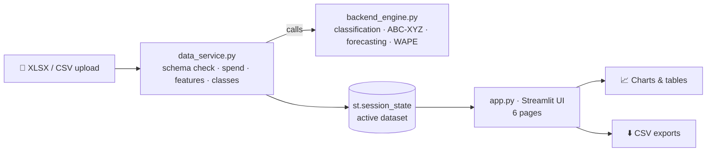

<div align="center">

# 🏭 Enterprise Procurement Intelligence

### From a raw procurement file to prioritised buying decisions, in one interactive dashboard

*Spend analytics · Demand classification · ABC–XYZ · Forecasting · Rule-based recommendations*


</div>

---

> **⚠️ Synthetic data.** Every part number, supplier, price and transaction in this repository is fictional and generated for demonstration. Nothing here represents real company data, and the platform has **not** been validated on real procurement records.

## ✨ What is this?

Purchasing teams in electronics manufacturing juggle hundreds of components, dozens of suppliers and demand that moves month to month. Answering *"where does our money go, which parts are unstable, who are we most exposed to, what will we need next quarter?"* usually means rebuilding the same pivot tables every cycle.

This project turns that routine into a **repeatable pipeline with an interactive Streamlit front end**: upload a 6‑month dataset, and the platform validates it, engineers demand features, classifies every part, forecasts the next six months and produces a prioritised review list for buyers.

<div align="center">

| 🔢 200 parts | 🏢 30 suppliers | 🧾 1,842 transactions | 💵 $22.7 M spend | 📅 Jan–Jun 2026 |
|:---:|:---:|:---:|:---:|:---:|

</div>

## 🖥️ The dashboard

<table>
<tr>
<td width="50%"><b>📂 Upload & Validation</b><br></td>
<td width="50%"><b>📈 Executive Overview</b><br></td>
</tr>
<tr>
<td><b>📊 Historical Demand Analytics</b><br></td>
<td><b>🔮 Demand Forecasting Engine</b><br></td>
</tr>
<tr>
<td><b>💳 Spend & Supplier Intelligence</b><br></td>
<td><b>🚨 Anomalies & Recommendations</b><br></td>
</tr>
</table>

## 🚀 Capabilities

| Module | What it does |
|---|---|
| **Data upload & validation** | Accepts `.xlsx` / `.csv`, checks the 8‑column data contract, builds spend (`Quantity × Unit Price`) and part‑level aggregates |
| **Executive overview** | KPI cards (spend, units, parts, suppliers), monthly spend trend, demand‑pattern mix |
| **Historical analytics** | Filter by category, pick any part, see its category, demand pattern, ABC‑XYZ class, 6‑month spend and demand history |
| **Forecasting engine** | Pattern‑routed 6‑month forecasts with backtest MAE / WAPE and a reliability flag, downloadable as CSV |
| **Spend & supplier intelligence** | ABC–XYZ matrix and top‑15 supplier spend |
| **Anomalies & recommendations** | Rule‑based buyer actions with priorities, exportable as CSV |

## 🧠 How the analytics work

All thresholds below are taken directly from `backend_engine.py`.

**Demand features** (per part, 6 monthly points): mean, standard deviation, coefficient of variation `CV = σ / μ`, count of zero months, zero months in each half, and a normalised linear trend slope (`slope / mean`).

**Demand pattern, applied in this order**

| # | Rule | Class |
|---|---|---|
| 1 | mean = 0 | No Demand |
| 2 | ≥ 2 zero months in first half and none in second | New Part Introduction |
| 3 | none in first half and ≥ 2 in second | Product Phase-Out |
| 4 | ≥ 2 zero months | Intermittent |
| 5 | CV > 1.0 | Highly Variable |
| 6 | slope > +5% / month · < −5% / month | Increasing · Decreasing |
| 7 | otherwise | Stable |

**ABC–XYZ**: parts are ranked by spend. **A** = cumulative spend ≤ 80%, **B** ≤ 95%, **C** the rest. **X** = CV ≤ 0.5 with no zero months, **Y** = 0.5 < CV ≤ 1.0, **Z** = CV > 1.0 *or* any zero month.

**Forecast routing**

| Demand pattern | Method | Notes |
|---|---|---|
| Stable, Highly Variable | Simple Exponential Smoothing | falls back to 3‑month moving average on failure |
| Increasing, Decreasing | Holt linear trend | falls back to SES; forecasts floored at 0 |
| New Part Introduction | 2‑month moving average | |
| Intermittent, Phase‑Out, No Demand | Naïve (last value) | |

Each forecast is back‑tested (train on months 1–5, test month 6) and flagged **Moderate**, **Low – Poor Backtest Fit** (WAPE > 50%) or **Low – Insufficient/Erratic History**.

**Recommendation rules**

| Trigger | Priority | Suggested action |
|---|---|---|
| Class **A** part with a single supplier | 🔴 Critical | Start sourcing a secondary supplier |
| Increasing demand | 🟠 High | Review forecast with supplier for capacity |
| Class AX / BX | 🟡 Medium | Long‑term volume contract, automated replenishment |
| Class CZ | 🟢 Low | Consider VMI or spot buying |

## 📊 Headline results on the synthetic dataset

Reproduced by re‑running the notebook logic against the included workbook.

- **Spend is concentrated:** the top 20 of 200 parts make up **73.2%** of spend; the top 3 suppliers hold **28.1%**.
- **Most parts are predictable:** 122 parts are class X, 38 Y and 40 Z. The single class **AX** (18 parts) carries **61.0%** of spend.
- **Demand mix:** Stable 90 · Decreasing 56 · Intermittent 19 · New Part 17 · Increasing 16 · Phase‑Out 1 · No Demand 1.
- **Recommendations:** 103 generated (14 Critical, 16 High, 44 Medium, 29 Low).

<table>
<tr>
<td width="50%"></td>
<td width="50%"></td>
</tr>
<tr>
<td colspan="2" align="center"><sub>Notebook outputs: Pareto of the top 20 parts and the ABC–XYZ part‑count matrix</sub></td>
</tr>
</table>

## 🎯 Honest forecast accuracy

Against a separate synthetic holdout (months 7–12), the engine scores **MAE 2,234 units per part‑month** and **WAPE 46.87%**.

<div align="center">

</div>

The forecast is smooth while the synthetic future swings by roughly ±20% month to month, and the engine under‑forecasts the six‑month total by about 9%. Treat forecasts as **directional guides for prioritising review**, not purchase quantities. This is synthetic‑on‑synthetic testing; it does not demonstrate performance on real demand.

## 🏗️ Architecture



- **`backend_engine.py`**: pure functions (forecast models, `classify_demand`, `assign_abc`, `assign_xyz`, `calculate_wape`) with no UI code.
- **`data_service.py`**: `process_uploaded_dataset(file_buffer, filename)` validates the contract, aggregates, engineers features and returns a result dictionary. It is wrapped in `st.cache_data`.
- **`app.py`**: sidebar navigation, session state and page rendering.

## 📁 Data contract

The upload must contain these columns (the workbook's main sheet is `Monthly_Demand`):

`Part Number` · `Annual Required Quantity` · `Unit Price` · `Part Name` · `Part Category` · `Supplier Name` · `Month` · `Monthly Demand Quantity`

One row is a part × supplier‑allocation × month record (1,842 rows for 200 parts × 6 months), so part‑level demand is always the **sum** of its supplier rows. The sample workbook also contains `Part_Master` and `Supplier_Master` sheets.

## ⚡ Quick start

```bash
git clone https://github.com/<your-username>/<your-repo>.git
cd <your-repo>
python -m venv .venv && source .venv/bin/activate      # Windows: .venv\Scripts\activate
pip install pandas numpy scikit-learn statsmodels openpyxl streamlit plotly
streamlit run app.py
```

Then open the **Data Upload & Validation** page and upload `electronics_procurement_synthetic.xlsx`.

> The **Load Default Synthetic Dataset** button currently reads `/content/data/raw/electronics_procurement_synthetic.xlsx` (a Google Colab path). Change `demo_path` in `app.py` to your local `data/raw/` location.

## 🗂️ Repository layout

```text
.
├── app.py                         # Streamlit interface
├── data_service.py                # ingestion, validation, feature engineering
├── backend_engine.py              # forecasting, classification, metrics
├── Procurement_Intellegence_Engine_.ipynb   # end-to-end analysis notebook
├── data/raw/
│   └── electronics_procurement_synthetic.xlsx
└── docs/images/                   # screenshots used in this README
```

## ⚠️ Known limitations

- **Six months of history** is too short for seasonality or stable trend estimates; classes can flip with one more month.
- **Single‑supplier alerts dominate.** 111 of 200 parts have one supplier in this dataset, and all 14 Critical recommendations come from that one rule. These are analytical flags for review, **not** confirmed supply risks, and do not authorise purchasing.
- **Trend threshold sensitivity.** The 5% slope cut‑off classes the 22 generator‑designed "Increasing" parts (slope ≈ 4.4%) as Stable; a lower threshold would change the counts.
- **Zero forecasts.** 31 parts receive an all‑zero forecast (including 30 with past demand), mostly Decreasing parts under Holt and Intermittent parts under the naïve method.
- **Anomaly rules found nothing.** With only 6 points per part, a z‑score cannot exceed 2.04, so the `> 2.5` volume rule can never fire; the price rule also found 0 hits.
- **No inventory, open orders, lead times or supplier performance data**, so nothing here is a replenishment or safety‑stock plan.
- **Data‑quality checks are partial.** Missing suppliers/prices, negatives and duplicates are demonstrated on an edge‑case file in the notebook, but the upload path itself currently only checks required columns.
- **Generator artefacts:** four supplier names contain symbols (`[A`, `\D`, `]G`, `^J`) and 16 part numbers have trailing spaces.
- **Not production‑ready:** there is no authentication, audit trail or monitoring.

## 🛣️ Roadmap

- [ ] Row‑level validation and quarantine in the upload path
- [ ] Rolling‑origin backtesting and error breakdown by pattern and ABC–XYZ class
- [ ] Intermittent‑demand methods (Croston / SBA) and forecast intervals
- [ ] Cache keys / dataset versioning to prevent stale results after re‑upload
- [ ] Unit tests in a `tests/` folder, run in CI
- [ ] Inventory, open‑PO and lead‑time inputs for replenishment logic
- [ ] Authentication, role‑based access and audit logging

## 🤝 Contributing

Issues and pull requests are welcome. Please keep any shared data synthetic.

## 📄 License

Add a license of your choice (for example MIT) before publishing.

---

<div align="center"><sub>Built with pandas · statsmodels · scikit‑learn · Streamlit · Plotly</sub></div>
